  

  Desenvolvedor Full Stack com foco em Front-End e UI/UX. Gosto de transformar ideias em interfaces intuitivas, funcionais e visualmente consistentes.
   
  <a href="https://portfolio-vanderlei.vercel.app/"><b>Ver portfólio →</b></a>

---

### 🚀 Projetos em destaque

  
  
  
  

### 🧰 Tecnologias e ferramentas

  

---

### 📊 GitHub Analytics

  

  

