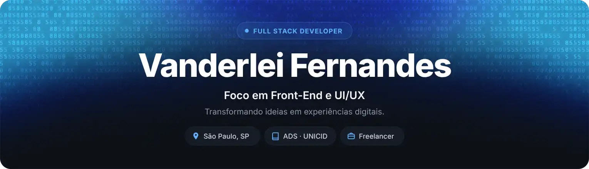

  

  
  
  

  <picture>
    <source media="(prefers-color-scheme: dark)" srcset="assets/about-dark.svg" />
    
  </picture>

  <picture>
    <source media="(prefers-color-scheme: dark)" srcset="assets/projects/title-dark.svg" />
    
  </picture>

  
  
  
  

  

---

  

